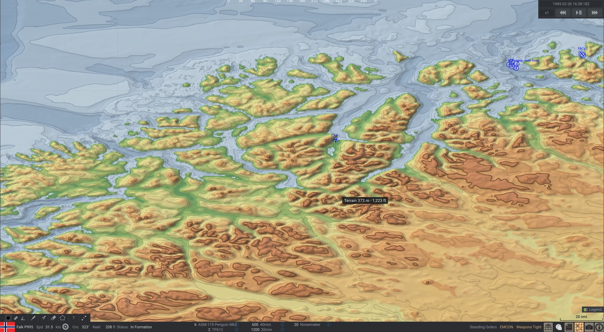
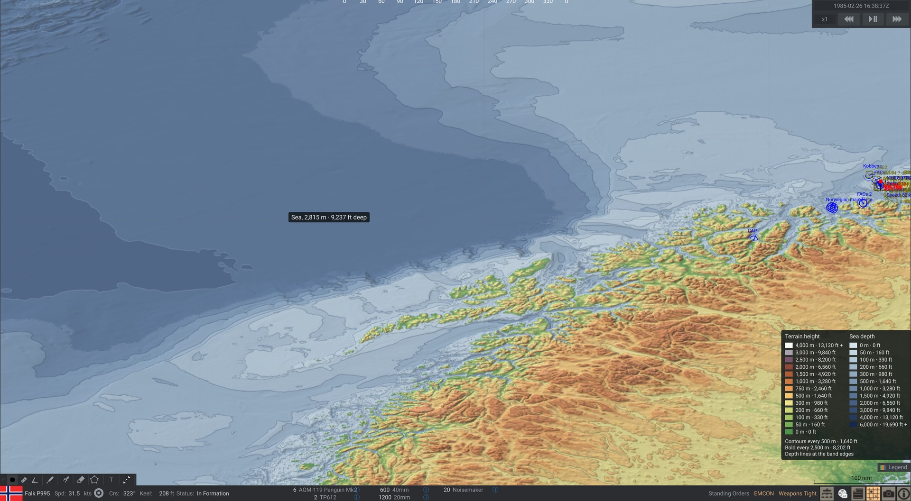
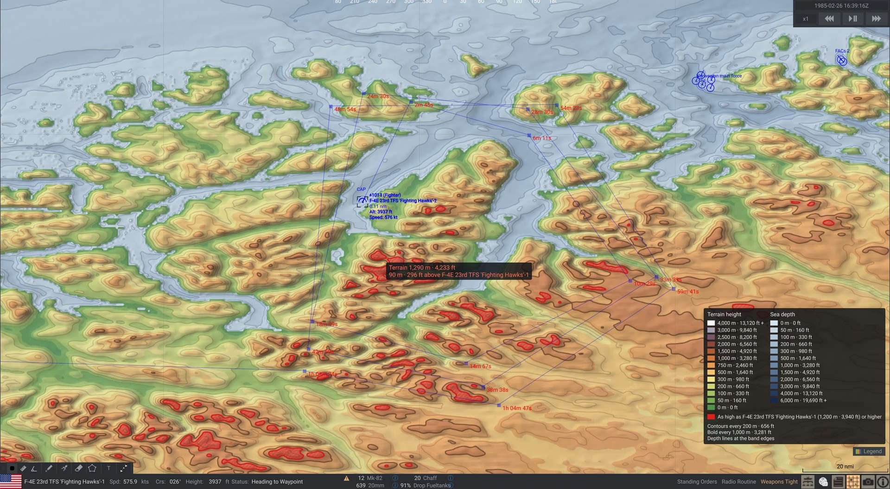
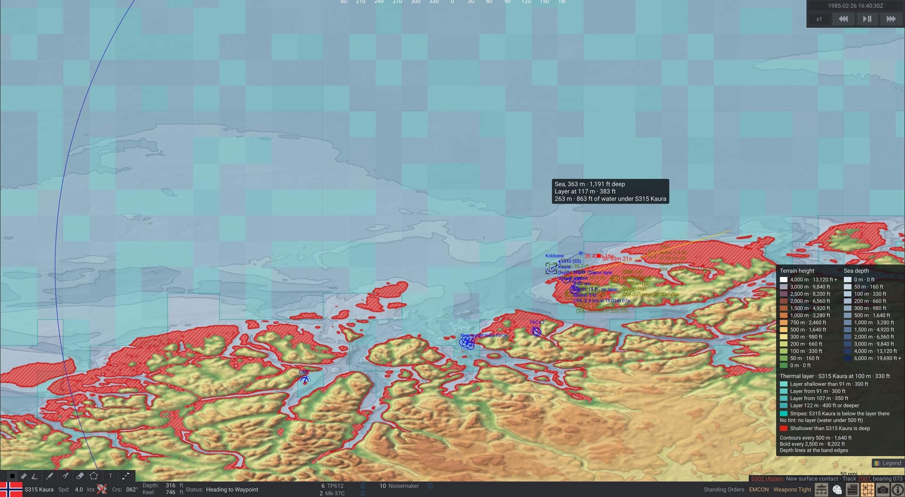
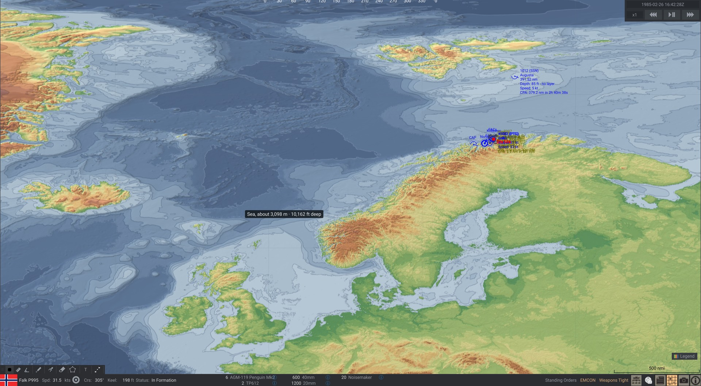

# Sea Power Topographic Map

**[Get it on the Steam Workshop](https://steamcommunity.com/sharedfiles/filedetails/?id=3826122523)** – requires
[Anchor Chain](https://steamcommunity.com/sharedfiles/filedetails/?id=3380210757).

> **Version 1.3.0 works on both maps**: Sea Power 0.8.7 and the new 3D globe map (public beta of 26 Oct 2026, the
> 11 November release) – see [Compatibility](#compatibility).

A mod for [Sea Power: Naval Combat in the Missile Age](https://store.steampowered.com/app/1286220/) that makes land
heights and sea depths readable on the tactical map – for low-level flying, terrain masking and radar horizons, and
for where a submarine has room to dive.



The stock map colours land only with its satellite-style texture and a faint slope shade, and paints all water one
flat colour: high ground is hard to judge and the seabed can't be seen at all. This mod adds a **Topography** layer:

- **Land tinted by height** in 13 bands (0 – 4000 m: greens, yellow, browns, grey, white), hill shading lit from the
  north-west, and contour lines whose step follows the zoom (20 m close in … 1000 m zoomed out, every fifth bold).
- **Sea tinted by depth** in 12 bands (0 – 6000 m), the deeper the darker, with faint seabed relief and a thin depth
  line at every band edge – banks, shelf edges and basins stand out like on a chart.
- **18 looks**, light and dark, behind the look button in the map's title bar (or Shift+F6): the map theme you are in
  decides which list it shows. Day: **Standard** (the original), **Atlas**, **Army tactical map**, **Paper sea chart**,
  **ECDIS day**, **Parchment**, **Glacier**. Night: **Midnight** (the default), **Standard**, **Quiet**, **Black**, **Atlas dusk**,
  **ECDIS dusk**, **Combat display**, **Phosphor green**, **Red light**, **Thermal imager**, **Neon**. The chart
  looks draw land flat with its contours and coastline and the sea in the four depth shades of a chart with a bold
  safety contour (the ECDIS ones in the real IHO S-52 colours).
- **Looks of your own from theme files**: the look list's **Save this look as a theme file** writes the look on the map as
  a small text file in `BepInEx\config\SeaPowerTopo\themes`; edit it (or write one that starts from another look with
  `Base=` and only lists what differs), save – the map reloads it at once. Format and every key: [docs/themes.md](docs/themes.md).
- **Height under the cursor** – terrain height in m and ft (or the sea depth) next to the mouse pointer; the
  **Cursor height** button in the title bar switches it off and on.
- **Terrain above the selected aircraft** – with an aircraft or helicopter in the air selected, terrain as high as or
  higher than its altitude is hatched red, and the readout gives the clearance ("Viper 2-1 clears it by 210 m").
- **Thermal layer for the selected submarine** – teal where the submarine, at its current depth, is below the
  game's thermal layer (hidden from hull sonars above it), faint teal where the layer is deeper, a thin line where
  the layer area ends (the game's 0.2° squares blend softly, the change lies on each square's edge). Water shallower
  than the submarine is hatched red; the readout adds the layer depth and the water under the keel.
- **No drawing while zoomed out** – at mission start the area around all units and the whole world are drawn once
  in the background. Zoomed out they are simply shown; closer in the view is drawn live, and the pre-drawn colours
  fill the edges while it catches up with a pan.
- **Buttons in the map's title bar**, left of the map menu (≡): **Topography** on/off, the look, **Legend**, **Cursor
  height** on/off. The look list and the legend drop down below them.
- **In the mission editor** too: its map gets the layer, the buttons, the legend and the cursor readout.
- **On the 3D globe map**: the overlay lies exactly on the stock map's globe at every zoom, at high latitudes, across
  the date line and over the poles.

| | |
| --- | --- |
|  |  |
|  |  |

All heights and depths are the ones the simulation itself uses: the game's own terrain data (the DEM), including the
terrain height multiplier and under-water depth factor from Options → World. Unit symbols, waypoints and labels stay
on top; the stock coastline is untouched. The map's night theme gets its own looks (Midnight by default).

## Installation

1. Install **[Anchor Chain](https://steamcommunity.com/sharedfiles/filedetails/?id=3380210757)**, the Sea Power
   community mod loader, following its
   [installation guide](https://seapower-modders.github.io/AnchorChain/install-anchor-chain.html) (one manual step:
   copy its preloader into the game folder).
2. Subscribe to **[Sea Power Topographic Map](https://steamcommunity.com/sharedfiles/filedetails/?id=3826122523)** on the Steam Workshop.
3. Start the game. In a mission, open the map: the layer is on. Its buttons sit in the map's title bar, left of the map
   menu (≡): **Topography** turns it on and off (also the map menu → Map Layers → **Topography**, or **F6**); the look
   button names the look and opens the list of looks (**Shift+F6** goes to the next one); **Legend** opens the colour
   key; **Cursor height** switches the readout next to the pointer. In the mission editor the same buttons sit at the
   top right of its map.

Manual install instead of the Workshop: put `SeaPowerTopo.dll` and `_info.ini` into
`<Sea Power>\Sea Power_Data\StreamingAssets\SeaPowerTopo\`.

## Settings

`<Sea Power>\BepInEx\config\dev.sewerlabs.seapowertopo.cfg` (created on the first start; changes apply on the next
redraw):

| Setting | What it does |
| --- | --- |
| Toggle key | Key for the layer (default F6) |
| Look (day map), Look (night map), Look key | The look for each map theme (Standard / Midnight by default; also set by the look button and Shift+F6); a look from a theme file is named by its `Id` |
| Chart safety contour | For the chart looks: the bold contour in metres (default 30); the shallowest water shade ends at a sixth of it, the deepest begins at three and a third times it |
| Opacity, Hill shading | How strongly the colours and the relief cover the stock map |
| Contour lines, Contour interval | Contours on/off; fixed step in metres or 0 = follows the zoom |
| Height bands, Depth bands | Lower edges of the colour bands in metres |
| Sea depth | Tint the sea by depth, or leave it to the stock map |
| Terrain above selected aircraft | The red highlight and clearance readout |
| Thermal layer for selected submarine | The thermal layer, shallow-water hatching and keel readout |
| Resolution | Overlay resolution relative to the map's (lower = faster) |
| Pre-draw mission area | Draw the mission area and the world once at mission start (less drawing while playing) |
| Height under cursor, Legend, Units | Readout with the layer / always / off (the Cursor height button is lit while it shows and switches it), legend button, metres / feet / both |

## Compatibility

- **Both maps in one package**: `SeaPowerTopo.dll` is the build for the 3D globe map (public beta of 26 Oct 2026,
  build 261026, and the 11 November release), `SeaPowerTopoFlat.dll` the one for 0.8.7's flat map (the 1.2.0 code, kept
  on the `flat-map` branch). Each stays off on the game the other is for; the log says which runs. They share the
  config file and theme files. (1.2.0 alone stops on the globe beta at the first mission.)
- **Anchor Chain on the beta:** Anchor Chain 1.1.0 doesn't start on the globe beta – its preloader looks for the mod
  folders before the game has listed them, so *no* Anchor Chain mod loads
  ([seapower-modders/AnchorChain#19](https://github.com/seapower-modders/AnchorChain/issues/19)). Until Anchor Chain is
  updated, [tools/anchorchain-beta-shim](tools/anchorchain-beta-shim) (dev only) starts it; see
  [docs/testing.md](docs/testing.md).
- The game updates often; if an update moves something the mod hooks into, the affected part stops and the log says
  why – the game itself keeps running.
- Works together with Better TacMap (separate map layer numbers).
- No game files are changed. Uninstall by unsubscribing (or deleting the folder).

Problems: `<Sea Power>\BepInEx\LogOutput.log` has a line for every step the mod takes (`[Info :SeaPowerTopo]`);
please attach it to a bug report.

## Building from source

Requires the .NET SDK 8, Sea Power installed (1.3.0 builds against the globe beta: Steam → Sea Power → Properties →
Betas), and Anchor Chain subscribed (the build references the game's and Anchor Chain's assemblies).

```bash
dotnet build src/SeaPowerTopo/SeaPowerTopo.csproj -c Release -p:GameDir="C:\Program Files (x86)\Steam\steamapps\common\Sea Power"
```

The build copies the mod into `<Sea Power>\Sea Power_Data\StreamingAssets\SeaPowerTopo\` (`-p:Deploy=false` to
skip). The release package (`tools/package.ps1`) adds the flat-map build from the `flat-map` branch, compiled against
a copy of 0.8.7's `Sea Power_Data\Managed` (`-FlatManagedDir`). `GameDir` can also be set as an environment variable. Release packaging and the Workshop upload are described
in [docs/workshop.md](docs/workshop.md); in-game test checklists are in [docs/testing.md](docs/testing.md).

Offline preview with the plugin's own colouring code and the game's terrain files – handy for tuning colours:

```bash
dotnet run --project tools/topo-preview -c Release -- --at 61.5,8 --span 2 --size 1600x900 --out norway.png
```

(`--at` lat,lon of the centre, `--span` view height in degrees; `--theme atlas` (any id from
`src/SeaPowerTopo/Render/Theme.cs`; without it Standard by day, `--dark` Midnight), `--theme-file my.ini` or
`--themes-dir <folder>` + `--theme <id>` for theme files, `--check-themes` to test them, `--chart-safety 50`;
`--danger 1200` adds the aircraft highlight, `--interval 100` a fixed contour step, `--nodepth` leaves the sea to the stock map,
`--depth-factor 2` is the game's under-water depth factor, `--sub 120` what a submarine at 120 m sees – with a
stand-in for the game's random layer depths, which need Unity – `--game <dir>` the game folder.)

## How it works

The stock map is a Unity scene – a unit globe made of lon/lat tiles – that a map camera renders into the texture the
map window shows (`SeaPower.LiveMap`, orthographic, looking at the view's centre). The mod adds meshes to that scene,
so the overlay turns and zooms with the globe for free. Each overlay image (a lon/lat rectangle) is cut along the stock
tiles' own 1° grid and the diagonal that splits each cell into two triangles, and every piece is placed in the plane of
the stock triangle under it with texture coordinates linear in lon/lat like the stock ones (`Render/GlobeMesh.cs`) – so
it lies exactly on the stock map at any zoom. The map texture has no depth buffer, so only the cells facing the camera
are meshed (the mesh is remade once the view has turned past its margin). An image's pixels span cos(latitude) more
degrees of longitude than of latitude, as wide on screen as high. The view, its scale and the part of the globe in
sight come from the map camera; the layers from the largest live map control (`RenderedLayer`).

Every layer is drawn the same way: heights copied out of the DEM on the main thread in 3 ms slices per frame, then
resampled (Catmull-Rom when zoomed in past the DEM) and coloured on half the CPU cores (a 4K view in about 70 ms). The
globe map keeps its terrain on the graphics card only, so the mod reads its own: the 3′ world grid (`lowres.raw`, 52 MB,
once, `Terrain/LowresGrid.cs`) and the 30″ chunks of the view – from the 3D terrain's cache (`TerrainLoader.TryGetCached`)
where it has them, else read with the game's reader on a worker thread, the last six kept (`Terrain/DemCache.cs`); both
from the files the game resolves, a mod's replacements included. The pre-drawn layers (mission area ×1, ×4, ×16 and the
world at 0.1°, up to 8 megapixels each, with mipmaps) stand in for the live layer while the view's scale is within 1.4×
zoomed in or 3× zoomed out of theirs. The live layer's image covers the view plus a margin (15–40 %, as much as an
8-megapixel budget allows) and is redrawn when the view leaves it, when a pan has used up most of the margin, or when
the zoom changes a lot. Layers in front cut holes into the ones behind (their mesh is the image minus the others'
rectangles), so the translucent colours never stack. The mission editor's map is a flat map of its own (Noesis tiles,
not the globe): there the live layer's image is a picture laid on its lon/lat rectangle by a `MapPanel` among the map's
background elements (`Render/FlatMapRef.cs`). The thermal layer comes from the game's own tile cache where a tile is
settled (`Environment._layerDepths`), otherwise from the same rule and the same seeded `UnityEngine.Random` draw, with
the generator's state put back.
A look is a plain parameter set (`Render/Theme.cs`): key colours spread over the height bands, in steps or
blended, or one flat colour; relief strength with a tinted shadow and highlight; contour lines with an optional glow;
a coastline; the sea's key colours or a chart's four depth shades; depth lines. The first release's look is one of
them, drawn by its original rules (its output is byte for byte unchanged). Adding a look is adding such a block, or a
theme file: `Render/ThemeIni.cs` reads and writes the file format and `Render/ThemeLibrary.cs` finds the files, resolves
`Base=`, keeps the last working version of a file that breaks, and swaps the result into `Themes` when the folder changes
(polled every 1.5 s); both are plain C# and tested offline by the preview tool's `--check-themes`.
The title bar buttons, the look list, the legend and the cursor readout are Noesis elements: the buttons go into the map
window's title bar row next to its menu (≡), the rest into a grid laid over the map control, handed over by a Harmony
postfix on `RenderedLayer.OnRender` that is applied only once NoesisGUI runs; the editor's map is found through its view
model. The few game internals the mod needs (the night state of the map's palette, a new Layers menu entry) are
reached by reflection in `GameApi.cs`.

Depths are the simulation's: the DEM depth times the game's under-water depth factor, doubled once more where the DEM
is shallower than 48 m (as every terrain lookup of the game does) – so a thin ring of shallower water can sit just
outside a coastal strip. That is how the simulation sees the seabed, not a drawing error.

```
src/SeaPowerTopo/
  Plugin.cs, Patches.cs      entry point (Anchor Chain plugin, game version check); mission start/end hooks, the late
                             map hook
  GameApi.cs                 the game internals reached by reflection
  TopoHost.cs                per-frame driver: layer entry, keys, selected aircraft / submarine, which overlay layers
                             show and draw, pre-drawn areas from the units, title bar buttons/legend/readout, the
                             mission editor's map
  TopoLayer.cs               the Topography entry in the map's Layers menu
  Terrain/HeightReader.cs    reads DEM chunks and the world grid (main thread), height under a point
  Terrain/LowresGrid.cs      the 3′ world grid, read from the game's file
  Terrain/DemCache.cs        DEM chunks the 3D terrain hasn't loaded, read on a worker thread
  Terrain/LayerMap.cs        the game's thermal layer per 0.2° tile
  Render/OverlayRenderer.cs  one overlay layer (live or pre-drawn): the map camera's view, mesh in the globe scene (or
                             a picture on the editor's map), redraw pipeline, holes
  Render/GlobeMesh.cs        an image's mesh on the stock map's globe
  Render/FlatMapRef.cs       the mission editor's flat map as a place to draw
  Render/Cutout.cs           an image minus the layers in front of it, as rectangles
  Render/Raster.cs           resampling, tint, hill shading, contours, red hatching, sea depth, thermal layer,
                             mipmaps (worker threads, plain C#)
  Render/Palette.cs          height and depth bands and their colours
  Ui/MapDecoration.cs        title bar buttons, look list, legend and cursor readout (Noesis)
  mod/_info.ini              Mod Manager entry
tools/topo-preview/          offline preview (links Raster.cs and Palette.cs)
tools/package.ps1            release build → dist/SeaPowerTopo/
tools/shot-director/         dev-only plugin that scripts the Workshop screenshots and in-game tests (docs/workshop.md)
tools/anchorchain-beta-shim/ dev-only BepInEx plugin that starts Anchor Chain on the globe beta (docs/testing.md)
workshop/                    Workshop description, preview.jpg, screenshots/
```

## License

[MIT](LICENSE). Not affiliated with Triassic Games or MicroProse. The mod reads the game's terrain data at runtime;
nothing of the game is included in this repository or in the mod.
