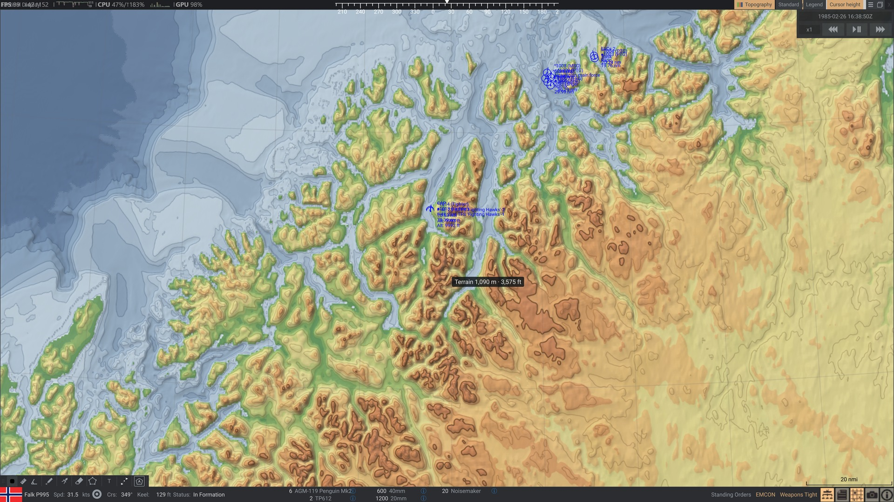
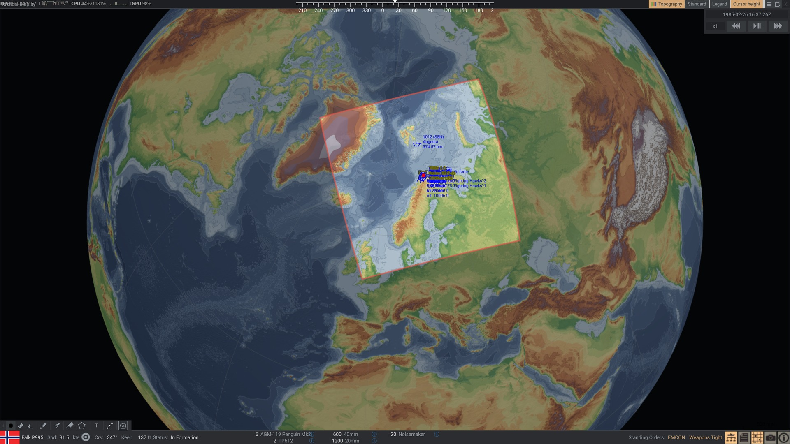
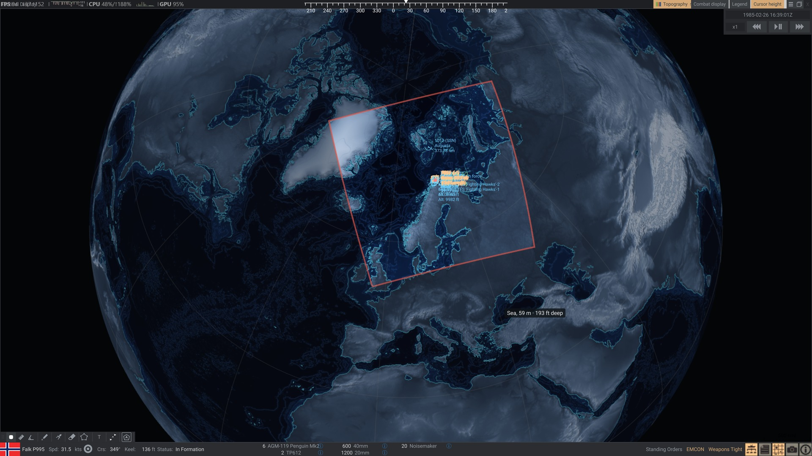
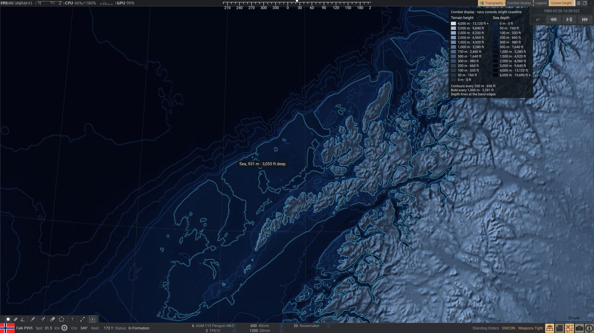
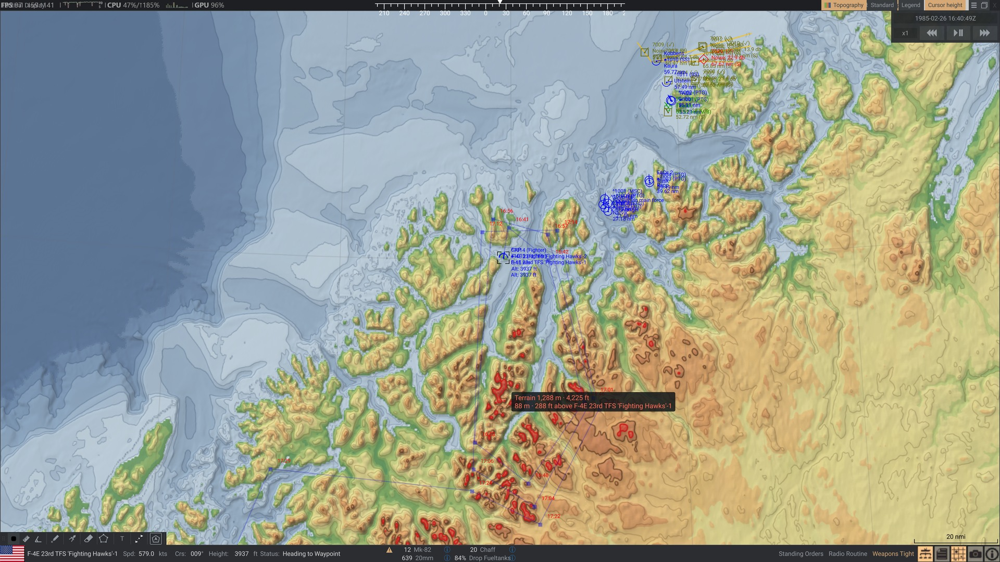
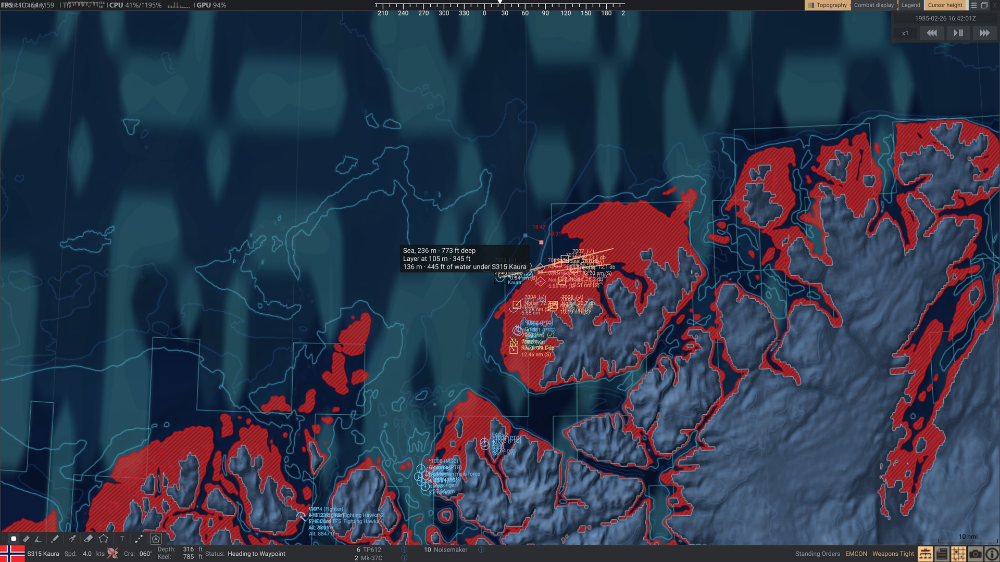
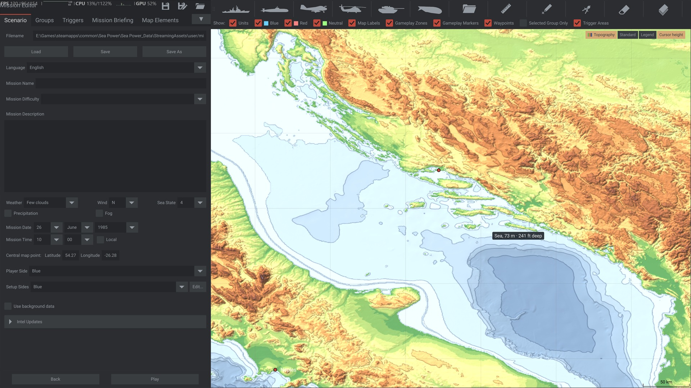

# Sea Power: R.A.T.S. Topographic Map

A mod for [Sea Power: Naval Combat in the Missile Age](https://store.steampowered.com/app/1286220/) that makes land heights
and sea depths readable on the tactical map. It helps with low-level flying, terrain masking, radar horizons and finding
room for a submarine to dive.

Needs a mod loader, either one: [R.A.T.S. Keel](https://steamcommunity.com/sharedfiles/filedetails/?id=3835527459) or
[Anchor Chain](https://steamcommunity.com/sharedfiles/filedetails/?id=3380210757).

- [Get it on the Steam Workshop](https://steamcommunity.com/sharedfiles/filedetails/?id=3826122523)
- [R.A.T.S. feedback board](https://hub.sewerlabs.dev/s/topo)



The stock map colours land with its satellite-style texture and a faint slope shade, and paints all water one flat colour.
This mod adds a Topography layer on top.

## What it does

### Land and sea

- Land is tinted by height in 13 bands (0 - 4000 m: greens, yellow, browns, grey, white).
- Hill shading is lit from the north-west.
- Contour lines follow the zoom: 20 m close in, 1000 m zoomed out, every fifth line bold.
- The sea is tinted by depth in 12 bands (0 - 6000 m), the deeper the darker.
  - Faint seabed relief and a thin depth line at every band edge make banks, shelf edges and basins stand out.
- Unit symbols, waypoints and labels stay on top. The stock coastline is untouched.

### Looks

- 19 looks, light and dark. The map theme you are in decides which list you see.
- Day looks: Standard, Army tactical map, Soviet General Staff map, Bathymetric chart, ECDIS day, Desert storm, Satellite,
  1940s chart, Glacier.
- Night looks: Midnight (the default), Standard, Black, Recon photo, Survey sonar, Combat display, Phosphor green, White
  phosphor, Amber display, Red light.
- ECDIS day draws land flat with contours and coastline, and the sea in four chart depth shades with a bold safety contour,
  in IHO S-52 colours. Survey sonar draws depth as a rainbow, like a multibeam survey.
- Pick a look in the title bar menu (Look), or press Shift+F6 for the next one.

### Looks of your own

- Look > Save this look as a theme file writes the current look to `BepInEx\config\SeaPowerTopo\themes`.
- Edit the file and save: the map reloads it at once.
- A file can start from another look with `Base=` and list only what differs.
- Format and every key: [docs/themes.md](docs/themes.md).

### Readouts and highlights

- The terrain height in m and ft (or the sea depth) shows next to the mouse pointer. The Cursor height entry switches it.
- With an aircraft or helicopter in the air selected, terrain as high as or higher than its altitude is hatched red.
  - The readout gives the clearance, for example "Viper 2-1 clears it by 210 m".
- With a submarine selected, the game's thermal layer is shown.
  - Teal tint: the submarine, at its current depth, is below the layer (hidden from hull sonars above it).
  - Faint teal: the layer is deeper. A thin line marks where the layer area ends.
  - Water shallower than the submarine is hatched red.
  - The readout adds the layer depth and the water under the keel.

### Map menu and where it works

- One menu button (the mountain mark) sits in the map's title bar, left of the map menu.
  - Its list has Topography on/off, Look, Legend and Cursor height.
  - Switches show On or Off and the list stays open. A switched-on entry is orange.
  - Look opens the list of looks in the same menu, with a Back row on top.
- The legend sits fixed at the map's top left, clear of the game's time controls.
- The mission editor's map gets the layer, the button, the legend and the cursor readout too.
- On the 3D globe map the overlay lies on the stock globe at every zoom, at high latitudes, across the date line and over
  the poles.
- At mission start the area around all units and the whole world are drawn once in the background, so nothing is drawn
  while zoomed out. Closer in, the view is drawn live.

| | |
| --- | --- |
|  |  |
|  |  |
|  |  |

### Where the data comes from

- Heights and depths are the ones the simulation uses: the game's own terrain data (the DEM).
- The terrain height multiplier and under-water depth factor from Options > World are applied.
- The layer is display-only. The mission's own zones and rules decide what counts in play.
- No game files are changed.

## Install

1. Install a mod loader, either one.
   - R.A.T.S. Keel: subscribe, switch it on in the Mods menu and copy its one stub file once. It is the loader that runs
     on the 3D-globe beta.
   - Anchor Chain: follow its [installation guide](https://seapower-modders.github.io/AnchorChain/install-anchor-chain.html).
2. Subscribe to [R.A.T.S. Topographic Map](https://steamcommunity.com/sharedfiles/filedetails/?id=3826122523) on the Workshop.
3. Start the game and open the map in a mission. The layer is on.
   - Topography on/off: the menu button, the map menu > Map Layers > Topography, or F6.
   - Next look: Shift+F6.
   - In the mission editor the button sits at the top left of its map.

Manual install instead of the Workshop: put `SeaPowerTopo.dll` and `_info.ini` into
`<Sea Power>\Sea Power_Data\StreamingAssets\SeaPowerTopo\`.

To uninstall, unsubscribe or delete the folder.

## Settings

- File: `<Sea Power>\BepInEx\config\dev.sewerlabs.seapowertopo.cfg`, created on the first start. Changes apply on the next
  redraw.

| Setting | What it does |
| --- | --- |
| Toggle key | Key for the layer (default F6) |
| Look (day map), Look (night map), Look key | The look for each map theme (Standard by day, Midnight by night; also set by the menu and Shift+F6). A look from a theme file is named by its `Id` |
| Chart safety contour | For the chart looks: the bold contour in metres (default 30). The shallowest water shade ends at a sixth of it, the deepest begins at three and a third times it |
| Opacity, Hill shading | How strongly the colours and the relief cover the stock map |
| Contour lines, Contour interval | Contours on/off; a fixed step in metres, or 0 to follow the zoom |
| Height bands, Depth bands | Lower edges of the colour bands in metres |
| Sea depth | Tint the sea by depth, or leave it to the stock map |
| Terrain above selected aircraft | The red highlight and clearance readout |
| Thermal layer for selected submarine | The thermal layer, shallow-water hatching and keel readout |
| Resolution | Overlay resolution relative to the map's (lower is faster) |
| Pre-draw mission area | Draw the mission area and the world once at mission start |
| Height under cursor, Legend, Units | Readout with the layer / always / off; the legend button; metres, feet or both |

## Compatibility

- Declared for Sea Power 0.8.7 up to every 0.9.x (`_info.ini`).
- Run in the game on 0.9.1 (build 261112) under Keel, in Red Sea Breakout (1.6.2). Other 0.9.x builds were checked offline.
- One package, two game builds: `SeaPowerTopo.dll` for the 3D globe map, `SeaPowerTopoFlat.dll` for 0.8.7's flat map. Each
  stays off on the game the other is for, and the log says which one runs. They share the config file and theme files.
- Both loaders run the same mod. Anchor Chain 1.1.0 does not start on the globe beta
  ([seapower-modders/AnchorChain#19](https://github.com/seapower-modders/AnchorChain/issues/19)), so there the mod runs under
  Keel. [tools/anchorchain-beta-shim](tools/anchorchain-beta-shim) starts Anchor Chain for development; see
  [docs/testing.md](docs/testing.md).
- The game updates often. If an update moves something the mod hooks into, the affected part stops and the log says why.
  The game keeps running.
- Works together with Better TacMap (separate map layer numbers).

## Feedback

- Bugs, ideas and questions go on the [R.A.T.S. feedback board](https://hub.sewerlabs.dev/s/topo).
- For a bug, link `<Sea Power>\BepInEx\LogOutput.log`. It has a line for every step the mod takes (`[Info :SeaPowerTopo]`).

## Building

- Needs the .NET SDK 8, Sea Power installed, and the R.A.T.S. Keel repo next to this one: the build compiles
  `SeaPowerKeel\shared\` into the DLL and takes `AnchorChain.dll` from Keel's copy.
- `GameDir` can also be set as an environment variable.

```bash
dotnet build src/SeaPowerTopo/SeaPowerTopo.csproj -c Release -p:GameDir="C:\Program Files (x86)\Steam\steamapps\common\Sea Power"
```

- The build copies the mod into `<Sea Power>\Sea Power_Data\StreamingAssets\SeaPowerTopo\` (`-p:Deploy=false` skips that).
- `tools/package.ps1` builds the release package. It adds the flat-map build (`-p:GameBuild=Flat`, `FLATMAP`), compiled
  against a copy of 0.8.7's `Sea Power_Data\Managed` (`-FlatManagedDir`).
- Packaging and the Workshop upload: [docs/workshop.md](docs/workshop.md). In-game test checklists: [docs/testing.md](docs/testing.md).
- How the overlay is drawn: [docs/how-it-works.md](docs/how-it-works.md).

Offline preview with the plugin's own colouring code and the game's terrain files, handy for tuning colours:

```bash
dotnet run --project tools/topo-preview -c Release -- --at 61.5,8 --span 2 --size 1600x900 --out norway.png
```

- `--at` is lat,lon of the centre, `--span` the view height in degrees, `--game <dir>` the game folder.
- `--globe` uses the globe map's narrower pixels (0.9 and later); without it the flat map's (0.8.7).
- `--theme <id>` takes any id from `src/SeaPowerTopo/Render/Theme.cs`; without it Standard by day, `--dark` Midnight.
- `--theme-file my.ini`, or `--themes-dir <folder>` with `--theme <id>`, previews theme files; `--check-themes` tests them.
- `--chart-safety 50`, `--danger 1200` (aircraft highlight), `--interval 100` (fixed contour step), `--nodepth` (sea left to the stock map).
- `--depth-factor 2` is the game's under-water depth factor; `--sub 120` shows what a submarine at 120 m sees, with a stand-in for the game's random layer depths.

## Layout

```
src/SeaPowerTopo/
  Plugin.cs, Hooks.cs        entry point (the Anchor Chain entry, which Keel runs too; ModEntry of the shared skeleton does the game version check,
                             settings, hooks and host); the late map hook
  ModInfo.cs                 what the shared skeleton reads (GUID, name, version, log source)
  Settings.cs                the config entries (Bind), the change counter the overlay redraws on
  TopoHost.cs                per-frame driver (ModHost): layer entry, keys, selected aircraft / submarine, which overlay
                             layers show and draw, pre-drawn areas from the units, title bar buttons/legend/readout, the
                             mission editor's map
  Terrain/HeightReader.cs    reads DEM chunks and the world grid (main thread), height under a point
  Terrain/LowresGrid.cs      the 3' world grid, read from the game's file
  Terrain/DemCache.cs        the DEM chunks the overlay draws from, read on a worker thread
  Terrain/EditorTerrain.cs   0.8.7 only: the mission editor's terrain folder, read by the mod itself
  Terrain/LayerMap.cs        the game's thermal layer per 0.2° tile
  Render/OverlayRenderer.cs  one overlay layer (live or pre-drawn): the map camera's view, mesh in the globe scene (or
                             a picture on the editor's map), redraw pipeline, holes
  Render/GlobeMesh.cs        an image's mesh on the stock map's globe
  Render/FlatMapRef.cs       the mission editor's flat map as a place to draw
  Render/Cutout.cs           an image minus the layers in front of it, as rectangles
  Render/Raster.cs           source grid, resampling, thermal layer tiles, mipmaps (worker threads, plain C#)
  Render/RasterShade.cs      tint, hill shading, contours, red hatching, sea depth, thermal layer per pixel
  Render/Look.cs             the look settings' defaults and how they scale a theme; chart depths
  Render/DemGrid.cs          the game's two height grids and where their samples sit
  Render/GeoRect.cs          a lon/lat rectangle
  Render/Palette.cs          height and depth bands and their colours
  Render/Theme*.cs           the looks that ship, theme files (format, loading)
  Ui/MapDecoration.cs        title bar buttons, look list, legend and cursor readout (Noesis)
  mod/_info.ini              Mod Manager entry
tools/topo-preview/          offline preview: compiles the plugin's plain C# Render files as they are
tools/package.ps1            release build → dist/SeaPowerTopo/
tools/shot-director/         dev-only plugin that scripts the Workshop screenshots and in-game tests, and the scripts
                             for the Workshop preview and the post pictures (docs/workshop.md)
tools/anchorchain-beta-shim/ dev-only BepInEx plugin that starts Anchor Chain on the globe beta (docs/testing.md)
workshop/                    Workshop description, preview.jpg, screenshots/
```

## Licenses and credits

- [R.A.T.S. Source License](LICENSE): read it, fork it, send fixes; no re-uploads, no reuse in other projects.
- Not affiliated with Triassic Games or MicroProse.
- The mod reads the game's terrain data at runtime. Nothing of the game is included in this repository or in the mod.
